<p align="center">
  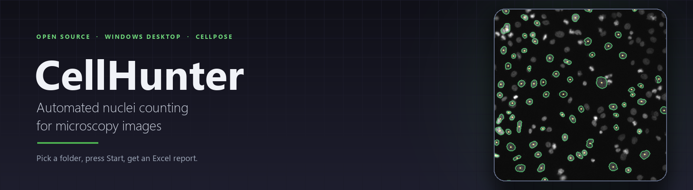
</p>

<p align="center">
  <a href="https://github.com/bat801/CellHunter/releases"></a>
  
  
  
  
  
</p>

**CellHunter counts nuclei in microscopy images and writes an Excel report.**
Pick a folder, press **Start**, and get one row per image — no scripts, no
notebooks, no coding.

It is a Windows desktop application (WPF, .NET 8) with a Python analysis
backend built on [Cellpose](https://github.com/MouseLand/cellpose). Everything
runs locally on your own computer; images are never uploaded anywhere.

<p align="center">
  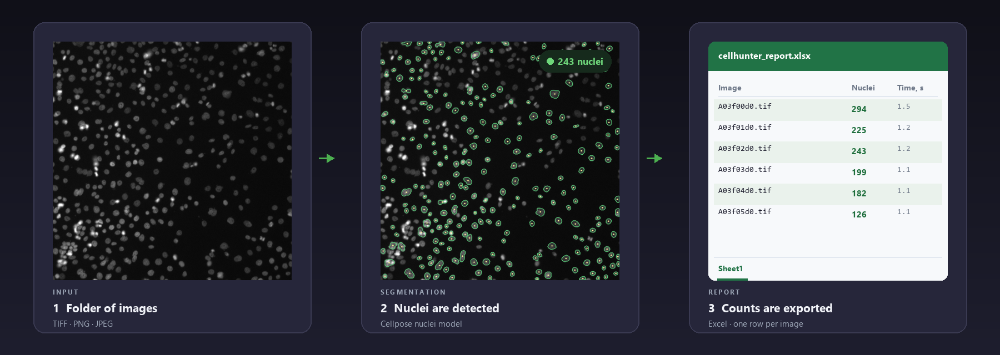
</p>

> **Project status: early-stage MVP.** The desktop shell and the Cellpose
> pipeline work end to end. Some repository areas (tests, installer, the
> **Excel** button in the UI) are still placeholders; see
> [Known limitations](#known-limitations).

---

## For biologists: three steps

<p align="center">
  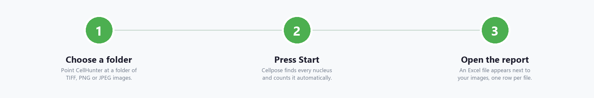
</p>

1. **Choose a folder** with your images — TIFF, PNG, JPEG or BMP.
2. **Press Start.** Cellpose finds the nuclei and counts them.
3. **Open the report.** `cellhunter_report_<timestamp>.xlsx` appears in the same
   folder, one row per image.

No command line is needed for this workflow. The report opens in Excel,
LibreOffice or any spreadsheet program.

---

## The interface

<p align="center">
  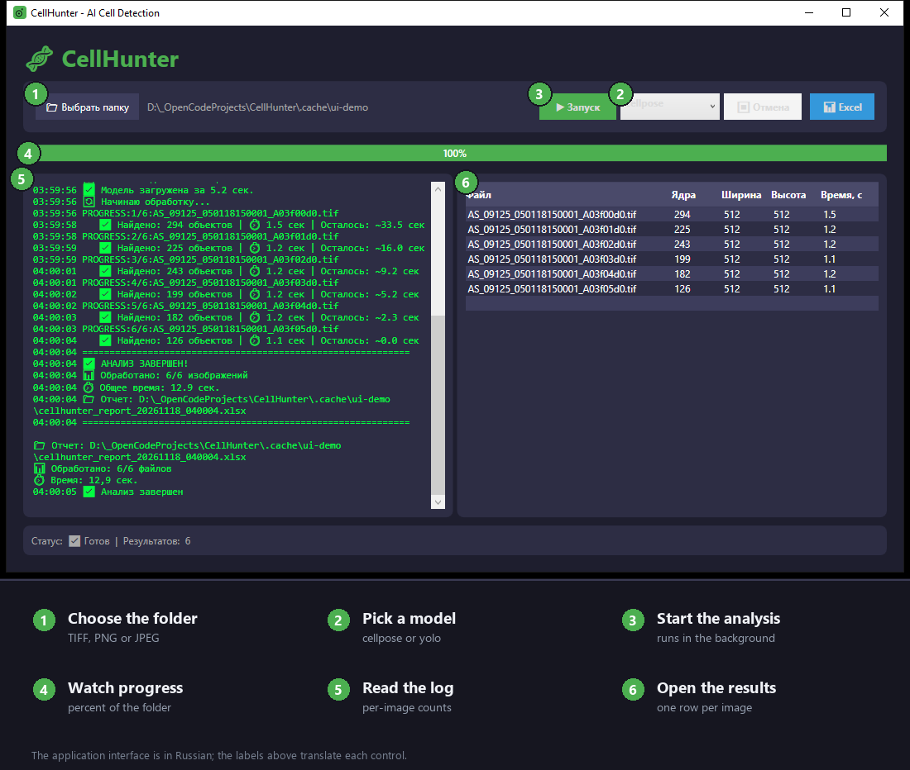
</p>

The window is deliberately small: folder, model, **Start**, progress, log and
results. The interface is currently in Russian — the numbered legend above
translates every control.

<table>
  <tr>
    <td width="33%" align="center">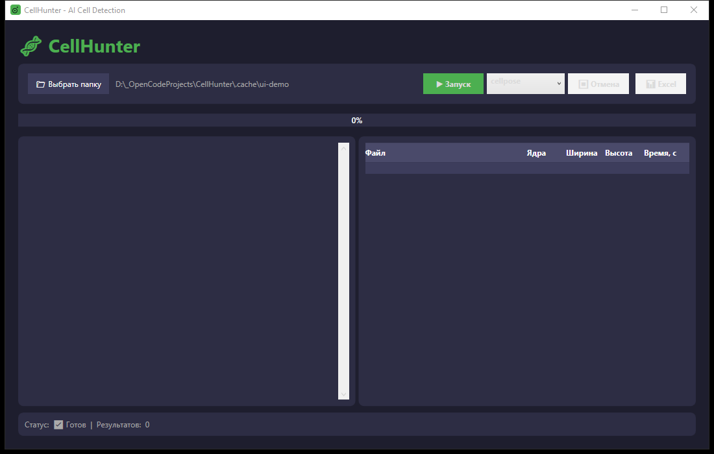<br><sub><b>1 · Ready.</b> A folder is selected and the model is set.</sub></td>
    <td width="33%" align="center">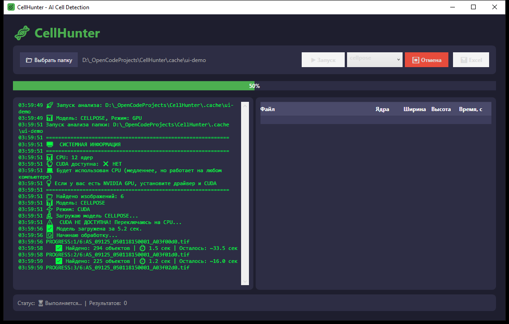<br><sub><b>2 · Running.</b> Progress and per-image log stream live.</sub></td>
    <td width="33%" align="center">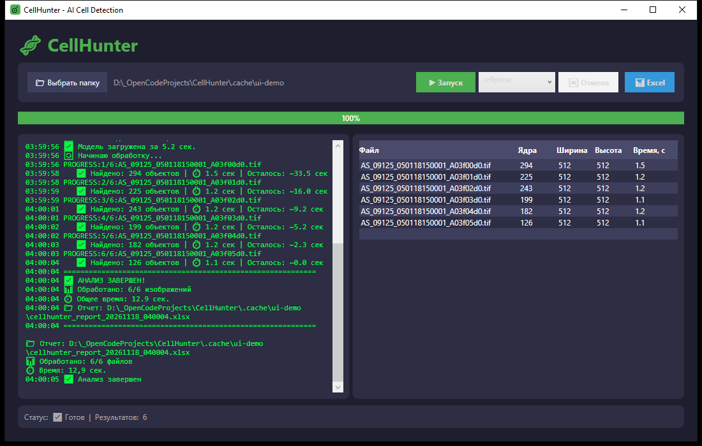<br><sub><b>3 · Done.</b> Results table and a written report.</sub></td>
  </tr>
</table>

<p align="center">
  
</p>

<sub>A real run on the six BBBC001 sample images, sped up for viewing on a
laptop CPU. No GPU is required.</sub>

---

## See it on real data

The pair below is the same 512×512 field before and after segmentation. Green
lines are Cellpose nucleus boundaries; dots mark centroids. The counts are the
actual output of the bundled sample run — not a mock-up.

<table>
  <tr>
    <td width="50%" align="center">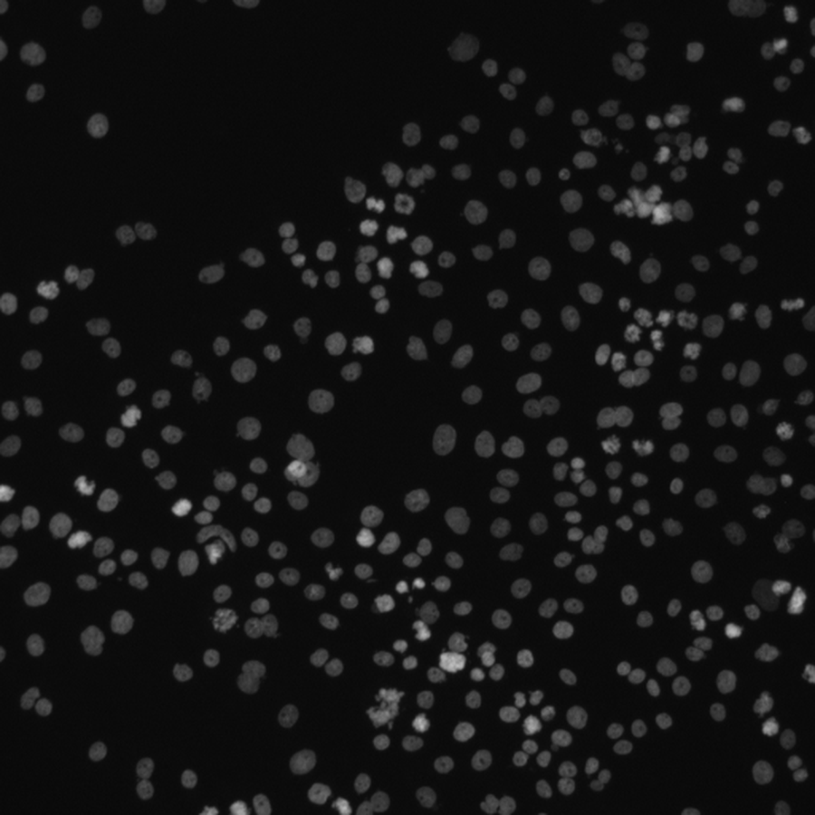</td>
    <td width="50%" align="center">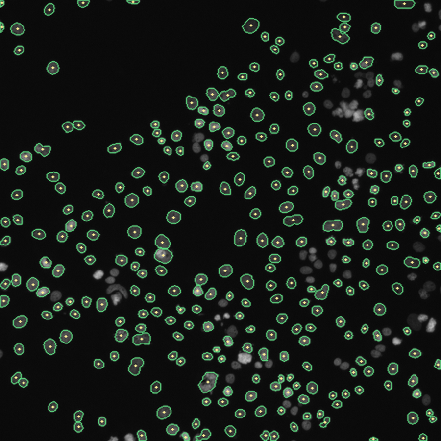</td>
  </tr>
  <tr>
    <td align="center"><sub>Raw image — <code>AS_09125_050118150001_A03f00d0.tif</code></sub></td>
    <td align="center"><sub>Cellpose result — <b>294 nuclei</b></sub></td>
  </tr>
</table>

<p align="center">
  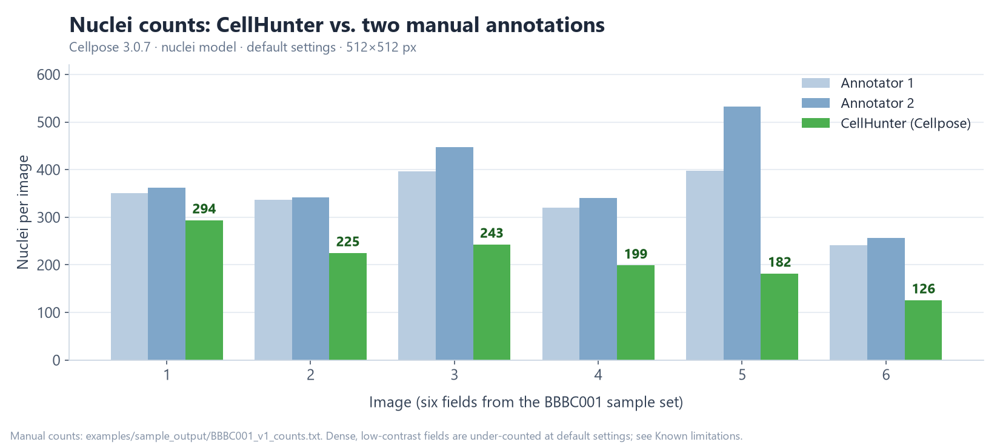
</p>

Two things are worth reading from this chart:

- CellHunter and the two human annotators follow the same trend across images.
- On these dense, low-contrast fields the automated count is lower than both
  manual annotations, which themselves differ by up to 34%. The stock `nuclei`
  model is trained mostly on fluorescent nuclei; faint brightfield-like cells
  are easy to miss with default settings. Treat the counts as a fast first pass
  and validate them against manual counts before publishing — exactly as the
  [Known limitations](#known-limitations) section says.

---

## How it works

<p align="center">
  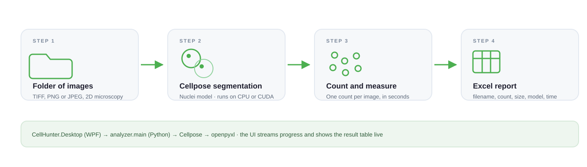
</p>

The desktop app starts the Python analyzer as a child process, reads its log
line by line, and shows progress immediately. When the analyzer finishes, it
writes the `.xlsx` file and returns a JSON summary that fills the results
table. Nothing leaves your machine.

---

## Example run: numbers and timing

Six images from the
[BBBC001](https://bbbc.broadinstitute.org/BBBC001) sample set, Cellpose 3.0.7
`nuclei` model, default settings, 12-core CPU, no GPU:

| Image | Annotator 1 | Annotator 2 | CellHunter |
|---:|---:|---:|---:|
| 1 | 350 | 362 | **294** |
| 2 | 336 | 342 | **225** |
| 3 | 396 | 447 | **243** |
| 4 | 320 | 341 | **199** |
| 5 | 398 | 533 | **182** |
| 6 | 241 | 257 | **126** |
| **Total** | **2,041** | **2,282** | **1,269** |

*Manual counts come with the sample set
(`examples/sample_output/BBBC001_v1_counts.txt`). This is an example run, not a
validation study.*

<p align="center">
  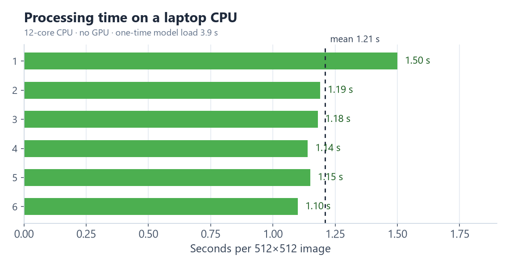
</p>

A 512×512 image takes about **1.2 seconds** on a laptop CPU. Startup and model
loading take about 5 seconds once per run, so the six-image run above completes
in roughly 13 seconds including startup. A CUDA-capable GPU is used
automatically when available and is much faster on larger images.

<p align="center">
  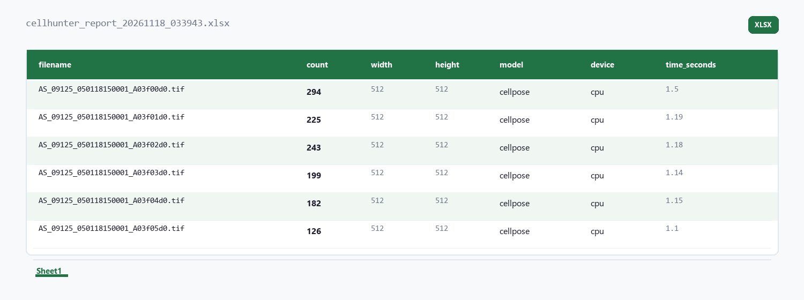
</p>

<sub>The report is written next to your images.</sub>

---

## Report format

The report is saved next to the analyzed images as
`cellhunter_report_<YYYYMMDD_HHMMSS>.xlsx`, one row per processed image:

| Column | Description |
|---|---|
| `filename` | Image file name |
| `count` | Number of detected nuclei |
| `width`, `height` | Image dimensions in pixels |
| `model` | Model used (`cellpose` / `yolo`) |
| `device` | Device actually used (`cpu` / `cuda`) |
| `time_seconds` | Processing time for this image |

If an image cannot be read or processed, it is skipped, the reason is printed
to the log, and the remaining images continue to run.

---

## Features

| Capability | Status |
|---|---|
| Batch analysis of a flat image folder | Implemented |
| Cellpose nuclei segmentation on GPU or CPU | Implemented |
| Live progress bar and log console | Implemented |
| Per-image results grid | Implemented |
| Automatic Excel report | Implemented |
| Model selection (Cellpose / YOLO) | Cellpose implemented, YOLO experimental |
| Preselect the folder from the command line | Implemented (`--folder`) |
| Image preview with detected-cell overlay | Planned |
| Cell area and density metrics | Planned |
| Recursive folder scanning | Planned |
| One-click installer | Not implemented |

---

## Known limitations

- Counts on dense or low-contrast images can be lower than manual annotations.
  Validate against your own ground truth before using them in publications.
- The GUI has no device selector: it requests GPU execution and relies on the
  automatic CPU fallback.
- Only top-level files in the selected folder are analyzed.
- The YOLO branch is experimental: it expects `models/yolov8n.pt` inside
  `CellHunter.Analyzer`, and the stock COCO weights do not detect cells.
- The **Excel** button in the UI is a placeholder; reports are generated
  automatically after each run.
- `tests/` and the packaging scripts (`scripts/build_windows.bat`,
  `scripts/installer.iss`) are still placeholders.
- OpenCV on Windows cannot read images from non-ASCII paths (for example a
  folder name in Cyrillic).
- The interface is only available in Russian for now.

---

## Download and quick start

Alpha builds are published on the
[Releases](https://github.com/bat801/CellHunter/releases) page.

The portable archive contains a self-contained desktop executable (no .NET
installation required), the Python analyzer sources and `requirements.txt`, but
not the Python environment itself. Unpack it, create a `venv` in the unpacked
folder, install the requirements, and start `CellHunter.Desktop.exe`:

```powershell
cd C:\CellHunter
py -3.12 -m venv venv
venv\Scripts\pip install -r requirements.txt
.\CellHunter.Desktop.exe
```

Cellpose downloads its pretrained nuclei weights on first use, so an internet
connection is required once. After that the app works offline.

A one-click installer is on the roadmap.

---

## Developer details

<details>
<summary><b>Build from source</b></summary>

### Python backend

```powershell
cd src\CellHunter.Analyzer
py -3.12 -m venv venv
venv\Scripts\python -m pip install --upgrade pip
venv\Scripts\pip install -r requirements.txt
```

`requirements.txt` pins a mutually compatible set around Cellpose 3.0.7.

**GPU support (optional).** The pinned `torch` wheel is CPU-only by default.
For CUDA acceleration, install the build that matches your driver from
[pytorch.org](https://pytorch.org/get-started/locally/) before installing the
remaining requirements.

### Desktop app

```powershell
dotnet build src\CellHunter.Desktop\CellHunter.Desktop.sln
dotnet run --project src\CellHunter.Desktop\CellHunter.Desktop\CellHunter.Desktop.csproj
```

Alternatively, open `src\CellHunter.Desktop\CellHunter.Desktop.sln` in Visual
Studio 2022 and press **F5**.

Local builds keep NuGet restore data inside the workspace: `NuGet.config`
redirects the packages folder to `.cache/`, and `scripts\build.ps1`
additionally points `TEMP`/`TMP` and the NuGet HTTP cache there. The folder is
ignored by git and can be deleted at any time.

```powershell
.\scripts\build.ps1                 # dotnet build -c Release
.\scripts\build.ps1 -Task Publish   # self-contained publish into .cache\publish
```

### Requirements

| Component | Requirement |
|---|---|
| OS | Windows 10/11 (64-bit) |
| .NET | .NET 8 SDK (to build), .NET 8 Desktop Runtime (to run) |
| Python | 3.10–3.12 (64-bit) |
| GPU | Optional NVIDIA GPU with CUDA for faster inference |
| Disk | ~5 GB for the Python environment and model weights |

</details>

<details>
<summary><b>Command-line usage</b></summary>

The analyzer can be used without the desktop app:

```powershell
cd src\CellHunter.Analyzer
venv\Scripts\python -m analyzer.main C:\data\experiment --model cellpose --gpu
```

| Option | Description |
|---|---|
| `<folder>` | Folder containing images (required) |
| `--model`, `-m` | `cellpose` (default) or `yolo` |
| `--device`, `-d` | `cpu` or `cuda`; defaults to auto-detection |
| `--cpu` | Force CPU execution |
| `--gpu` | Force CUDA execution (falls back to CPU if unavailable) |

Supported formats: `.jpg`, `.jpeg`, `.png`, `.tif`, `.tiff`, `.bmp`.
Only the top level of the folder is scanned — subfolders are not traversed.

The desktop executable also accepts a folder to preselect, which is handy for
shortcuts and automated screenshots:

```powershell
CellHunter.Desktop.exe --folder "D:\images\experiment"
```

</details>

<details>
<summary><b>Configuration</b></summary>

`PythonBridge` resolves its environment at runtime; no paths are hard-coded.

| Variable | Purpose |
|---|---|
| `CELLHUNTER_ANALYZER_DIR` | Explicit path to the `CellHunter.Analyzer` directory |
| `CELLHUNTER_PYTHON` | Explicit path to the Python interpreter |

Discovery order for the analyzer directory:

1. `CELLHUNTER_ANALYZER_DIR`
2. the application directory (published layout)
3. parent directories up to the repository root (development layout)

Discovery order for the interpreter:

1. `venv`, `.venv`, `env`, `.env` inside the analyzer directory
2. `CELLHUNTER_PYTHON`
3. bundled `CellHunterAnalyzer.exe` (if present)
4. `python.exe` on `PATH`

If nothing is found, the app shows an actionable error listing every location
it checked and the exact commands needed to create the environment.

</details>

<details>
<summary><b>Architecture and protocol</b></summary>

```
┌──────────────────────────────────────────────────────────┐
│ CellHunter.Desktop — WPF, .NET 8, MVVM                   │
│  folder picker · model selector · progress bar           │
│  log console · results grid · status bar                 │
└──────────────────────────┬───────────────────────────────┘
                           │ Process + stdio (unbuffered)
                           │ PROGRESS:…, JSON between markers
┌──────────────────────────▼───────────────────────────────┐
│ CellHunter.Analyzer — Python 3.10–3.12                   │
│  main.py · Cellpose 3 (nuclei)                           │
│  OpenCV · NumPy · pandas · openpyxl                      │
└──────────────────────────┬───────────────────────────────┘
                           ▼
              cellhunter_report_<timestamp>.xlsx
```

1. The WPF app (`MainViewModel`) validates the selected folder and starts
   `PythonBridge`.
2. `PythonBridge` locates the analyzer directory and a Python interpreter, then
   runs `python -u -m analyzer.main <folder> --model <model> --gpu|cpu`.
3. `main.py` loads the requested model (Cellpose or YOLO), iterates over the
   images in the folder, and prints a machine-readable progress line for every
   file: `PROGRESS:<current>/<total>:<file name>`.
4. When finished, the backend writes the Excel report into the selected folder
   and prints a JSON summary between `===CELLHUNTER_JSON_START===` and
   `===CELLHUNTER_JSON_END===` markers.
5. `PythonBridge` parses the JSON, raises `AnalysisCompleted`, and the view
   model fills the results grid and resets the UI state.

The marker-based protocol is intentionally simple: the backend can also be
invoked from the command line or wrapped by another client.

</details>

<details>
<summary><b>Project structure</b></summary>

```
CellHunter/
├── src/
│   ├── CellHunter.Desktop/            # WPF front end (.NET 8)
│   │   └── CellHunter.Desktop/
│   │       ├── Models/                # AnalysisSummary, ImageAnalysisResult
│   │       ├── Services/              # IPythonBridge, PythonBridge
│   │       ├── Utils/                 # RelayCommand, ObservableObject, converter
│   │       ├── ViewModels/            # MainViewModel
│   │       ├── Assets/                # application icon
│   │       ├── App.xaml(.cs)
│   │       └── MainWindow.xaml(.cs)
│   └── CellHunter.Analyzer/           # Python backend
│       ├── analyzer/main.py           # CLI, detection loop, Excel export
│       ├── examples/                  # BBBC001 sample images and expected counts
│       ├── tests/                     # placeholder
│       └── requirements.txt
├── docs/
│   ├── images/                        # figures and screenshots used in this README
│   └── requirements.txt               # extra packages for regenerating them
├── scripts/
│   ├── build.ps1                      # workspace-local build
│   ├── capture-ui.ps1                 # automated UI screenshots
│   ├── make_docs_data.py              # runs Cellpose on the sample images
│   ├── make_docs_figures.py           # charts, overlays, diagrams, banner
│   └── make_docs_screenshots.py       # screenshots, annotations, demo GIF
└── README.md
```

Sample data lives in `src/CellHunter.Analyzer/examples/`; expected counts for
the BBBC001 set are in `examples/sample_output/`.

</details>

<details>
<summary><b>Regenerating the images in this README</b></summary>

Every figure and screenshot comes from the repository's own sample data. The
pipeline is reproducible and writes only inside `.cache/` (ignored by git):

```powershell
python scripts\make_docs_data.py           # Cellpose run, masks, timings, xlsx
python scripts\make_docs_figures.py        # overlays, charts, banner, diagrams
powershell -File scripts\capture-ui.ps1    # real app screenshots + GIF frames
python scripts\make_docs_screenshots.py    # annotated screenshot and demo.gif
```

`docs/requirements.txt` lists the extra packages (matplotlib, Pillow, openpyxl)
on top of the analyzer requirements. The `nuclei` weight file is cached in
`.cache/cellpose`.

</details>

<details>
<summary><b>Troubleshooting</b></summary>

| Symptom | Likely cause | Fix |
|---|---|---|
| “Python not found” error on start | No `venv` and no Python on `PATH` | Create the environment as shown above, or set `CELLHUNTER_PYTHON` |
| “Analyzer not found” error | App is not running from the repository or a published layout | Set `CELLHUNTER_ANALYZER_DIR` |
| GPU is reported as unavailable | PyTorch CPU wheel or no CUDA driver | Install a CUDA-enabled PyTorch build; the app falls back to CPU automatically |
| Analysis is slow | Running on CPU | Install the CUDA build of PyTorch, or reduce image size |
| Image is skipped as unreadable | Non-ASCII path (e.g. Cyrillic) — OpenCV limitation on Windows | Move the images to an ASCII-only path |
| First run is slow or fails offline | Cellpose is downloading pretrained weights | Ensure internet access for the first run |

</details>

---

## Data and credits

The sample images are **BBBC001** from the
[Broad Bioimage Benchmark Collection](https://bbbc.broadinstitute.org/BBBC001)
— human HT-29 colon cancer cells. Manual annotations ship with the dataset and
are used here for the comparison chart.

Segmentation is performed by **Cellpose**:

> Stringer, C., Wang, T., Michaelos, M. & Pachitariu, M.
> *Cellpose: a generalist algorithm for cellular segmentation.*
> Nature Methods **18**, 100–106 (2021).
> [doi:10.1038/s41592-020-01018-x](https://doi.org/10.1038/s41592-020-01018-x)

Built with .NET 8, WPF, OpenCV, NumPy, pandas and openpyxl.

<sub>Maintainers: the social preview for the GitHub repository card is
`docs/images/social-preview.png`; the application icon is
`docs/images/app.ico` (embedded into the executable from
`src/CellHunter.Desktop/CellHunter.Desktop/Assets/app.ico`).</sub>

---

## Contributing

Issues and pull requests are welcome. Please keep commits focused and follow
the [Conventional Commits](https://www.conventionalcommits.org/) format, and
make sure the solution builds with no warnings:

```powershell
dotnet build src\CellHunter.Desktop\CellHunter.Desktop.sln
```

---

## Roadmap

- [ ] Image preview with detected-cell overlay
- [ ] Cell area and density metrics in the report
- [ ] Recursive folder scanning and batch queue
- [ ] Working export button and report re-opening
- [ ] Trained YOLO weights (or removal of the YOLO branch)
- [ ] Unit tests for the bridge protocol and the analyzer
- [ ] PyInstaller bundle and Inno Setup installer
- [ ] English localization of the UI

---

## License

Released under the MIT License. See [LICENSE](LICENSE).
